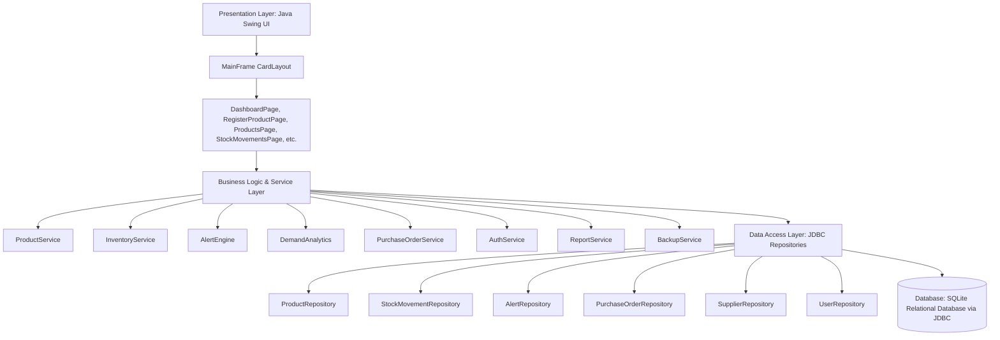

# IntelliStock AI — Intelligent Inventory & Stock Management System

[](https://adoptium.net/)
[](https://maven.apache.org/)
[](https://sqlite.org/)
[]()
[]()

> **Project Purpose:** IntelliStock AI is an enterprise desktop inventory and stock management system designed for physical businesses, warehouses, and distribution centers. It manages products, real-time inventory counts, supplier relationships, purchase orders, partial goods receipts, dispatches, and rule-based smart stock alerts.  
> *(Note: This is a physical inventory system, **not** a stock-market trading application.)*

---

## Table of Contents
1. [Key Features](#key-features)
2. [Mandatory Technology Stack](#mandatory-technology-stack)
3. [Architecture Overview](#architecture-overview)
4. [Prerequisites & System Requirements](#prerequisites--system-requirements)
5. [Setup & Launch Instructions](#setup--launch-instructions)
6. [Pre-configured Demonstration Credentials](#pre-configured-demonstration-credentials)
7. [System Modules Guide](#system-modules-guide)
8. [Automated Testing & Results](#automated-testing--results)
9. [Documentation Directory](#documentation-directory)

---

## 1. Key Features

- **Product Registration:** Complete registration form capturing SKU, product name, category, unit of measurement, initial stock, reorder threshold, critical threshold, warehouse/rack locations, cost price, selling price, barcode, and expiry date. Validates required inputs, enforces duplicate SKU constraints, and records opening stock movements within a single atomic database transaction.
- **Real-Time Product Inventory:** Search, filter by category or stock status (`NORMAL`, `LOW`, `CRITICAL`, `OUT_OF_STOCK`, `ARCHIVED`), view inventory valuation, edit product metadata, and archive discontinued items.
- **Transaction-Safe Stock Movements:** Record receipts, customer dispatches, customer returns, damaged items, and audit-logged adjustments. Enforces non-negative stock constraints with automated rollbacks on invalid operations.
- **Smart Stock Alert Engine:** Rule-based evaluations of inventory records trigger out-of-stock, critical-stock, low-stock, and expiration alerts. Features alert acknowledgement and automated resolution upon replenishment.
- **Demand Analytics & Moving-Average Forecasting:** Evaluates recent daily outbound dispatches against historical baseline periods to calculate inventory run rate, days remaining, velocity classification (`FAST`, `MEDIUM`, `SLOW`, `NO_MOVEMENT`), and suggested reorder quantities. *(Note: Algorithm is transparent moving-average math, not an opaque machine-learning model).*
- **Purchase Order Procurement Lifecycle:** Manage end-to-end purchasing: draft creation, order submission, partial/full goods receipt with automatic stock increments, and cancellations.
- **Supplier Relationship Management:** Maintain vendor directories, contact details, active statuses, and linked catalog supplies.
- **Reporting & CSV Export:** Live preview and single-click UTF-8 BOM CSV export for inventory valuation, stock statuses, movement audit trails, supplier directories, and expiry tracking.
- **Role-Based Security & Audit Logging:** PBKDF2 with HMAC-SHA256 password hashing. Enforces permissions separating `ADMIN` and `STAFF` roles with complete audit trail logging.
- **Database Backup & Disaster Recovery:** Zero-downtime online SQLite WAL checkpointing and atomic `VACUUM INTO` backups, with full validation and one-click database restore.

---

## 2. Mandatory Technology Stack

| Component | Technology | Description |
| :--- | :--- | :--- |
| **Language** | **Java 21** | Eclipse Adoptium OpenJDK 21 LTS |
| **GUI Framework** | **Java Swing** | Desktop UI with native look-and-feel, custom theme, and responsive CardLayout |
| **Persistence** | **JDBC & SQLite** | Pure Java JDBC (`java.sql.Connection`, `PreparedStatement`, `ResultSet`, Transactions) |
| **Database Driver**| **sqlite-jdbc 3.47.1.0** | Managed via Maven dependencies |
| **Build & Packaging** | **Apache Maven 3.9.9** | Multi-module wrapper (`mvnw.cmd`), Shade plugin for executable fat JAR |
| **Automated Testing** | **JUnit 5 (Jupiter 5.11.4)** | Comprehensive unit and integration test suite (20 automated tests) |

---

## 3. Architecture Overview

IntelliStock AI strictly adheres to a **3-Tier Layered Architecture** with Object-Oriented design principles:



---

## 4. Prerequisites & System Requirements

- **Operating System:** Windows 10/11, macOS, or Linux.
- **Java Development Kit:** JDK 21 (Eclipse Adoptium OpenJDK 21 recommended).
- **Environment Variable:** Set `JAVA_HOME` to your JDK 21 installation path.
  - Windows Default Adoptium Location:  
    `%LOCALAPPDATA%\Programs\Eclipse Adoptium\jdk-21.0.12.101-hotspot`

---

## 5. Setup & Launch Instructions

### Step 1: Open Terminal in Project Directory
```powershell
cd C:\Users\udays\intellistock-ai
```

### Step 2: Compile the Project
Using the included Maven wrapper:
```powershell
.\mvnw.cmd compile
```

### Step 3: Run the Automated Test Suite
```powershell
.\mvnw.cmd test
```
*Expected: 20 passed tests, 0 failures, 0 errors.*

### Step 4: Package Executable Fat JAR
```powershell
.\mvnw.cmd package
```
This generates `target\intellistock-ai.jar` containing all compiled classes, resources, and SQLite JDBC driver dependencies.

### Step 5: Launch the Application
Run via the one-click batch script:
```powershell
.\run.cmd
```
Or directly using Java:
```powershell
java -jar target\intellistock-ai.jar
```

To reset the demonstration database to clean initial sample data on launch, pass the flag:
```powershell
java -jar target\intellistock-ai.jar --reset-demo
```

---

## 6. Pre-configured Demonstration Credentials

The application initializes with demonstration user accounts:

| Role | Username | Password | Permissions |
| :--- | :--- | :--- | :--- |
| **Administrator** | `admin` | `Admin@123` | Full Access (Inventory, Dispatches, Adjustments, User Management, Backups, Settings) |
| **Warehouse Staff** | `staff` | `Staff@123` | Operational Access (View Catalog, Register Products, Receipts, Dispatches, View Alerts) |

---

## 7. System Modules Guide

1. **Dashboard:** High-level executive overview displaying total product counts, stock volume, valuation, pending purchase orders, low/critical items, 7-day movement charts, and recent audit activity.
2. **Register Product:** Swing form providing full validation for new SKUs, category assignment, thresholds, pricing, storage locations, and opening stock.
3. **Products (Catalog):** Real-time inventory grid with live status badges (`NORMAL`, `LOW`, `CRITICAL`, `OUT_OF_STOCK`, `ARCHIVED`), multi-filter search, product editing dialogs, and archiving.
4. **Stock Movements:** Record manual stock transactions (`RECEIPT`, `DISPATCH`, `RETURN`, `DAMAGED`, `ADJUSTMENT`, `CORRECTION`) with references, mandatory reasons for discrepancies, and a historical audit trail.
5. **Smart Alerts:** Real-time alert list highlighting out-of-stock items, critical thresholds, low stock, expired products, and moving-average reorder alerts with acknowledgement and resolution tracking.
6. **Suppliers:** Directory of suppliers with contact details, status toggling, and view of linked inventory products.
7. **Purchase Orders:** Complete procurement workflow with draft creation, submission, and transaction-safe partial or full goods receipt.
8. **Demand Analysis:** Moving-average outbound velocity calculation, run-rate projection (days remaining), and suggested reorder quantities.
9. **Reports & CSV Export:** On-screen data grids and spreadsheet-ready CSV downloads with UTF-8 BOM encoding for inventory valuation, stock movements, and suppliers.
10. **User Management (Admin Only):** User account provisioning, role assignment (`ADMIN` / `STAFF`), password resets, and account activation/deactivation.
11. **Settings & Maintenance:** Configurable algorithm parameters (moving average window, high demand ratio, expiry lead days), one-click SQLite database backup and restore, and demonstration data reset.

---

## 8. Automated Testing & Results

The project includes 20 comprehensive JUnit 5 tests covering all core business logic, database transactions, security, and edge cases.

To execute tests:
```powershell
.\mvnw.cmd test
```

### Test Summary:
```
[INFO] -------------------------------------------------------
[INFO]  T E S T S
[INFO] -------------------------------------------------------
[INFO] Running com.intellistock.AlertEngineTest (2 tests) - PASSED
[INFO] Running com.intellistock.AuthServiceTest (5 tests) - PASSED
[INFO] Running com.intellistock.DemandAnalyticsTest (1 test) - PASSED
[INFO] Running com.intellistock.EndToEndLiveTest (1 test) - PASSED
[INFO] Running com.intellistock.InventoryServiceTest (5 tests) - PASSED
[INFO] Running com.intellistock.ProductServiceTest (4 tests) - PASSED
[INFO] Running com.intellistock.PurchaseOrderServiceTest (2 tests) - PASSED
[INFO] 
[INFO] Results:
[INFO] Tests run: 20, Failures: 0, Errors: 0, Skipped: 0
[INFO] BUILD SUCCESS
```

---

## 9. Documentation Directory

Detailed project documentation is available in the `docs/` folder:
- [Database Schema & ER Diagram](docs/DATABASE_SCHEMA.md)
- [Test Plan & Verification Results](docs/TEST_RESULTS.md)
- [College Mini-Project Academic Report](docs/COLLEGE_MINI_PROJECT_REPORT.md)
- [Project Presentation Outline & Viva Guide](docs/PRESENTATION_OUTLINE.md)
- [Example Operational Workflows](docs/EXAMPLE_WORKFLOWS.md)
