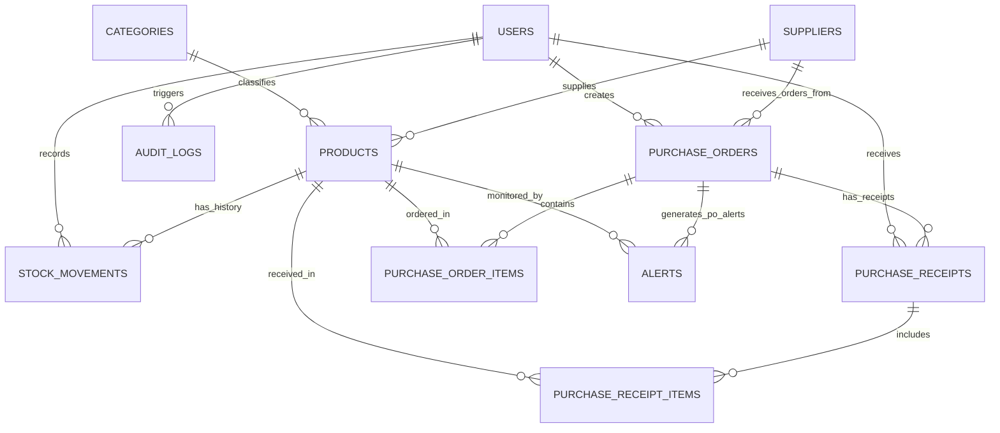

# IntelliStock AI — Database Schema & Relational Design

## 1. Overview & Storage Engine

IntelliStock AI uses **SQLite** as its persistent local relational database engine, interfaced exclusively through standard Java **JDBC** (`java.sql.Connection`, `PreparedStatement`, `ResultSet`, and transactions). 

### Connection Configuration & Pragmas
Every database connection opened via `Database.open()` automatically configures:
```sql
PRAGMA foreign_keys = ON;
PRAGMA busy_timeout = 5000;
```
This guarantees strict relational integrity and prevents locking contention during multi-threaded Swing worker tasks.

---

## 2. Entity-Relationship (ER) Diagram



---

## 3. Relational Table Specifications

### 3.1. `users`
Stores user credentials, full names, roles, and active flags.
```sql
CREATE TABLE IF NOT EXISTS users (
    id INTEGER PRIMARY KEY AUTOINCREMENT,
    username TEXT NOT NULL COLLATE NOCASE UNIQUE,
    password_hash TEXT NOT NULL,
    full_name TEXT NOT NULL,
    role TEXT NOT NULL CHECK (role IN ('ADMIN', 'STAFF')),
    active INTEGER NOT NULL DEFAULT 1 CHECK (active IN (0, 1)),
    created_at TEXT NOT NULL
);
```
- **Constraints:** `username` is case-insensitive unique (`COLLATE NOCASE UNIQUE`).
- **Security:** `password_hash` stores PBKDF2 with HMAC-SHA256 hashed passwords with random 16-byte salt and 65,536 iterations. Plaintext passwords are never stored.

### 3.2. `categories`
Stores product taxonomy and classification categories.
```sql
CREATE TABLE IF NOT EXISTS categories (
    id INTEGER PRIMARY KEY AUTOINCREMENT,
    name TEXT NOT NULL COLLATE NOCASE UNIQUE
);
```

### 3.3. `suppliers`
Stores vendor contact details, address, and partnership status.
```sql
CREATE TABLE IF NOT EXISTS suppliers (
    id INTEGER PRIMARY KEY AUTOINCREMENT,
    company_name TEXT NOT NULL,
    contact_person TEXT,
    email TEXT,
    phone TEXT,
    address TEXT,
    notes TEXT,
    active INTEGER NOT NULL DEFAULT 1 CHECK (active IN (0, 1)),
    created_at TEXT NOT NULL
);
```

### 3.4. `products`
The central catalog entity managing SKUs, live inventory counts, thresholds, prices, and locations.
```sql
CREATE TABLE IF NOT EXISTS products (
    id INTEGER PRIMARY KEY AUTOINCREMENT,
    sku TEXT NOT NULL COLLATE NOCASE UNIQUE,
    name TEXT NOT NULL,
    category_id INTEGER NOT NULL REFERENCES categories(id),
    description TEXT,
    unit TEXT NOT NULL,
    barcode TEXT,
    quantity INTEGER NOT NULL DEFAULT 0 CHECK (quantity >= 0),
    reorder_threshold INTEGER NOT NULL CHECK (reorder_threshold >= 0),
    critical_threshold INTEGER NOT NULL CHECK (critical_threshold >= 0),
    warehouse_location TEXT,
    rack_shelf TEXT,
    expiry_date TEXT,
    cost_price_cents INTEGER NOT NULL CHECK (cost_price_cents >= 0),
    selling_price_cents INTEGER NOT NULL CHECK (selling_price_cents >= 0),
    preferred_supplier_id INTEGER REFERENCES suppliers(id),
    archived INTEGER NOT NULL DEFAULT 0 CHECK (archived IN (0, 1)),
    created_at TEXT NOT NULL,
    updated_at TEXT NOT NULL
);
```
- **Integrity Constraints:**
  - `CHECK (quantity >= 0)`: Database-enforced rule preventing negative inventory quantities.
  - `CHECK (cost_price_cents >= 0)` & `CHECK (selling_price_cents >= 0)`: Monomorphic non-negative integer cent storage (avoids floating-point arithmetic errors).
  - Partial Unique Index on barcode:
    ```sql
    CREATE UNIQUE INDEX IF NOT EXISTS idx_products_barcode
        ON products(barcode)
        WHERE barcode IS NOT NULL AND TRIM(barcode) <> '';
    ```

### 3.5. `stock_movements`
Immutable append-only ledger recording all stock fluctuations with audit references.
```sql
CREATE TABLE IF NOT EXISTS stock_movements (
    id INTEGER PRIMARY KEY AUTOINCREMENT,
    product_id INTEGER NOT NULL REFERENCES products(id),
    movement_type TEXT NOT NULL CHECK (movement_type IN (
        'INITIAL_STOCK', 'RECEIPT', 'DISPATCH', 'RETURN',
        'ADJUSTMENT', 'DAMAGED', 'CORRECTION', 'PO_RECEIPT'
    )),
    quantity INTEGER NOT NULL CHECK (quantity > 0),
    quantity_delta INTEGER NOT NULL,
    previous_quantity INTEGER NOT NULL CHECK (previous_quantity >= 0),
    resulting_quantity INTEGER NOT NULL CHECK (resulting_quantity >= 0),
    reason TEXT,
    reference TEXT,
    purchase_order_id INTEGER,
    purchase_receipt_id INTEGER,
    user_id INTEGER NOT NULL REFERENCES users(id),
    occurred_at TEXT NOT NULL
);
```
- **Audit Consistency:** Records snapshot of `previous_quantity` and `resulting_quantity` alongside `quantity_delta` for complete forensic audibility.

### 3.6. `purchase_orders`
Tracks procurement orders issued to suppliers.
```sql
CREATE TABLE IF NOT EXISTS purchase_orders (
    id INTEGER PRIMARY KEY AUTOINCREMENT,
    supplier_id INTEGER NOT NULL REFERENCES suppliers(id),
    status TEXT NOT NULL CHECK (status IN (
        'DRAFT', 'PENDING', 'PARTIALLY_RECEIVED', 'RECEIVED', 'CANCELLED'
    )),
    expected_delivery_date TEXT,
    notes TEXT,
    created_by INTEGER NOT NULL REFERENCES users(id),
    created_at TEXT NOT NULL,
    submitted_at TEXT,
    cancelled_at TEXT
);
```

### 3.7. `purchase_order_items`
Line items belonging to purchase orders.
```sql
CREATE TABLE IF NOT EXISTS purchase_order_items (
    id INTEGER PRIMARY KEY AUTOINCREMENT,
    purchase_order_id INTEGER NOT NULL REFERENCES purchase_orders(id) ON DELETE CASCADE,
    product_id INTEGER NOT NULL REFERENCES products(id),
    quantity_ordered INTEGER NOT NULL CHECK (quantity_ordered > 0),
    quantity_received INTEGER NOT NULL DEFAULT 0 CHECK (quantity_received >= 0),
    unit_cost_cents INTEGER NOT NULL CHECK (unit_cost_cents >= 0),
    UNIQUE (purchase_order_id, product_id),
    CHECK (quantity_received <= quantity_ordered)
);
```
- **Constraint:** `CHECK (quantity_received <= quantity_ordered)` guarantees over-receipt cannot occur at the database level.

### 3.8. `purchase_receipts` & `purchase_receipt_items`
Idempotent receipts representing physical deliveries received at the warehouse loading dock.
```sql
CREATE TABLE IF NOT EXISTS purchase_receipts (
    id INTEGER PRIMARY KEY AUTOINCREMENT,
    purchase_order_id INTEGER NOT NULL REFERENCES purchase_orders(id),
    received_by INTEGER NOT NULL REFERENCES users(id),
    received_at TEXT NOT NULL,
    notes TEXT,
    idempotency_key TEXT NOT NULL UNIQUE
);

CREATE TABLE IF NOT EXISTS purchase_receipt_items (
    id INTEGER PRIMARY KEY AUTOINCREMENT,
    receipt_id INTEGER NOT NULL REFERENCES purchase_receipts(id) ON DELETE CASCADE,
    product_id INTEGER NOT NULL REFERENCES products(id),
    quantity INTEGER NOT NULL CHECK (quantity > 0)
);
```

### 3.9. `alerts`
Stores rule-based operational warnings.
```sql
CREATE TABLE IF NOT EXISTS alerts (
    id INTEGER PRIMARY KEY AUTOINCREMENT,
    product_id INTEGER REFERENCES products(id),
    purchase_order_id INTEGER REFERENCES purchase_orders(id),
    alert_type TEXT NOT NULL,
    severity TEXT NOT NULL CHECK (severity IN ('INFO', 'WARNING', 'CRITICAL')),
    message TEXT NOT NULL,
    explanation TEXT,
    status TEXT NOT NULL CHECK (status IN ('ACTIVE', 'ACKNOWLEDGED', 'RESOLVED')),
    created_at TEXT NOT NULL,
    updated_at TEXT NOT NULL,
    resolved_at TEXT
);
```
- **Deduplication Constraints:**
  Unique partial indexes ensure at most one active/acknowledged alert per product/type and PO/type:
  ```sql
  CREATE UNIQUE INDEX IF NOT EXISTS idx_alerts_active_product
      ON alerts(product_id, alert_type)
      WHERE status IN ('ACTIVE', 'ACKNOWLEDGED') AND product_id IS NOT NULL;

  CREATE UNIQUE INDEX IF NOT EXISTS idx_alerts_active_po
      ON alerts(purchase_order_id, alert_type)
      WHERE status IN ('ACTIVE', 'ACKNOWLEDGED') AND purchase_order_id IS NOT NULL;
  ```

### 3.10. `audit_logs`
Chronological record of user actions and security events.
```sql
CREATE TABLE IF NOT EXISTS audit_logs (
    id INTEGER PRIMARY KEY AUTOINCREMENT,
    user_id INTEGER REFERENCES users(id),
    action TEXT NOT NULL,
    entity_type TEXT,
    entity_id INTEGER,
    details TEXT,
    created_at TEXT NOT NULL
);
```

### 3.11. `app_settings`
Key-value configuration storage for moving average parameters and operational rules.
```sql
CREATE TABLE IF NOT EXISTS app_settings (
    key TEXT PRIMARY KEY,
    value TEXT NOT NULL
);
```

---

## 4. Transaction Boundaries & ACID Guarantees

All multi-step operations execute inside `Database.inTransaction(connection -> ...)` with `connection.setAutoCommit(false)`, `commit()`, and `rollback()` inside a try-catch block:

1. **Product Registration:**
   - Verify SKU uniqueness.
   - Insert category if new.
   - Insert product row.
   - If initial quantity > 0: insert `INITIAL_STOCK` record into `stock_movements`.
   - Insert `PRODUCT_REGISTER` into `audit_logs`.
   - Commit transaction.
2. **Stock Movements (Receipt / Dispatch / Adjustment):**
   - Read product row inside transaction.
   - Calculate resulting stock; throw exception if `< 0`.
   - Update `products.quantity`.
   - Insert record into `stock_movements`.
   - Record audit trail into `audit_logs`.
   - Commit transaction.
3. **Goods Receipt (PO Receipt):**
   - Check idempotency key.
   - Validate received quantity <= outstanding.
   - Insert `purchase_receipts` header.
   - Insert `purchase_receipt_items` lines.
   - Update `purchase_order_items.quantity_received`.
   - Update `products.quantity`.
   - Insert `PO_RECEIPT` into `stock_movements`.
   - Update `purchase_orders.status` (`PARTIALLY_RECEIVED` or `RECEIVED`).
   - Insert `audit_logs` record.
   - Commit transaction.
